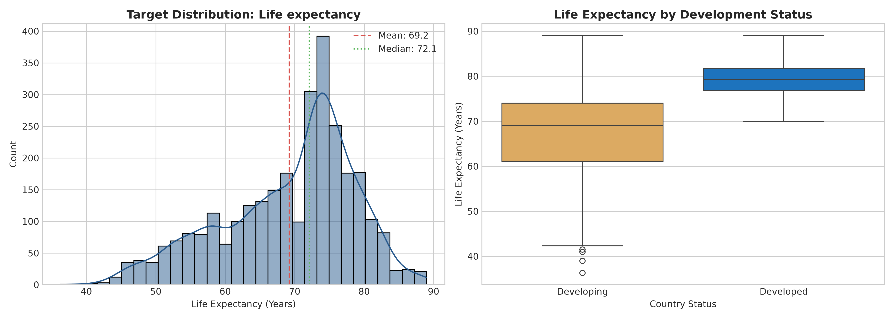
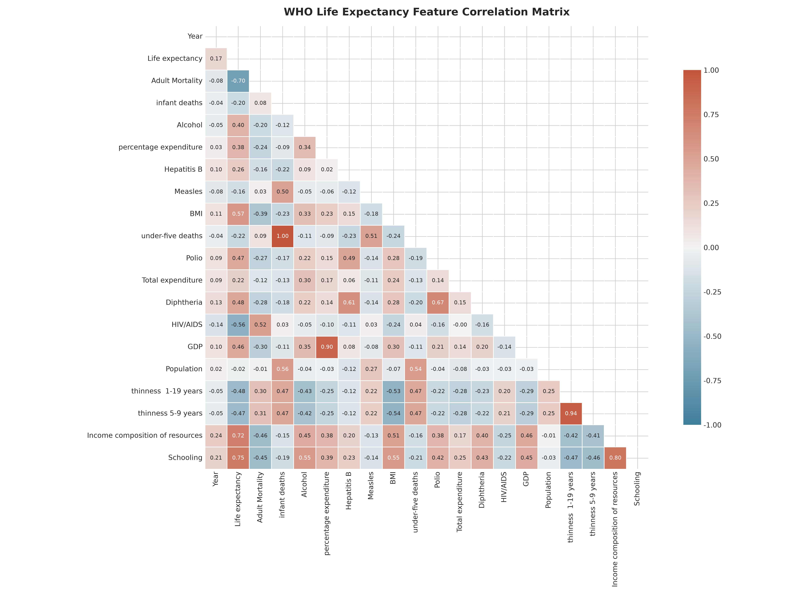
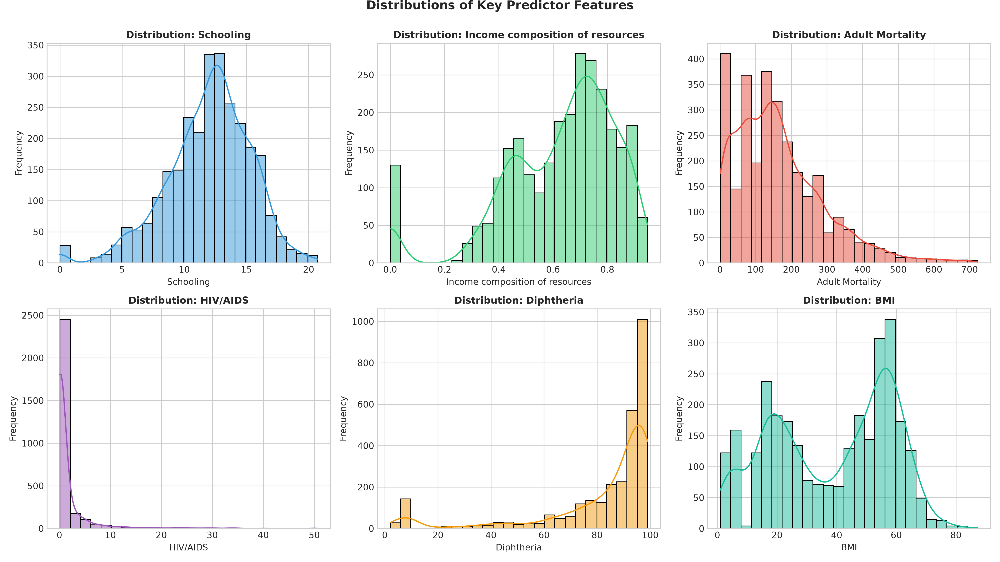
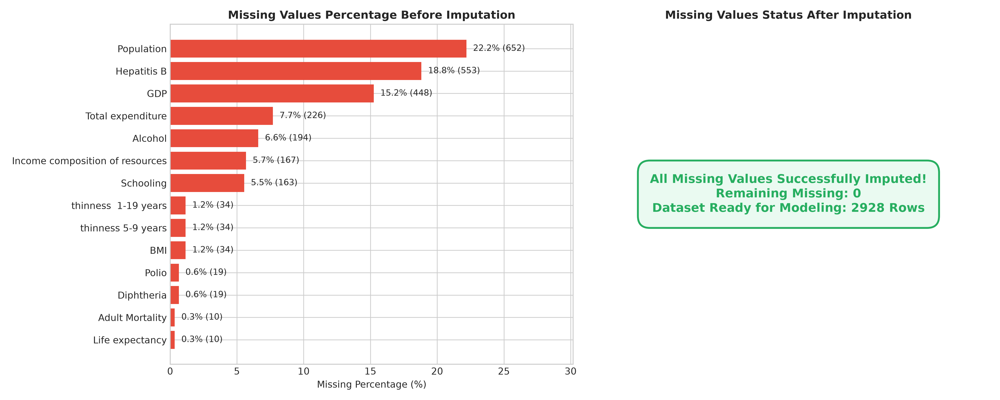
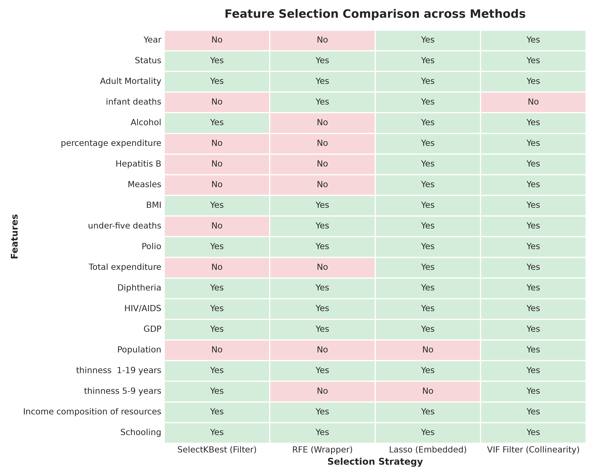
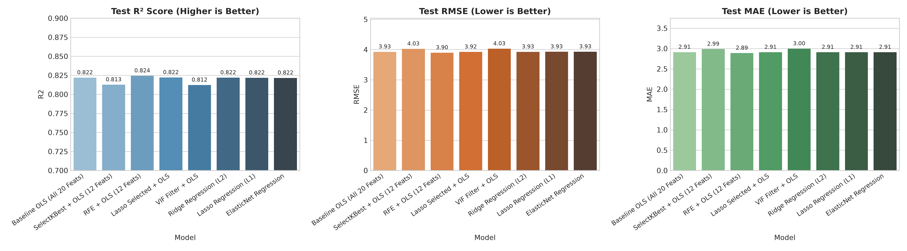
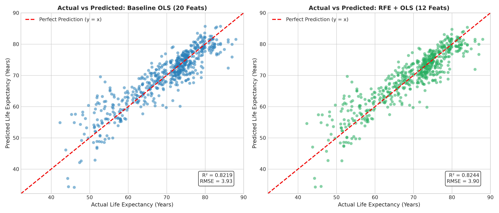
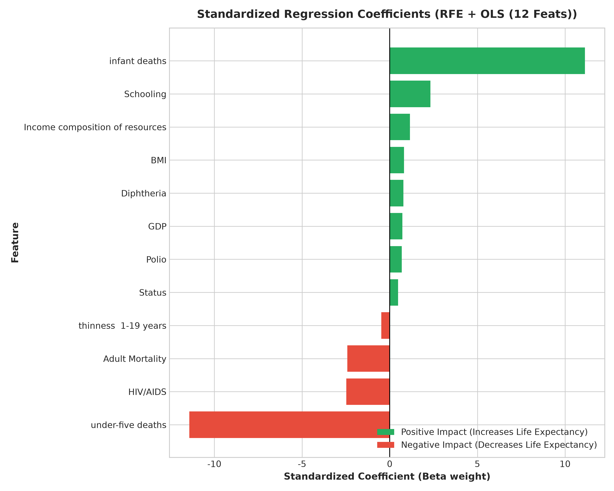
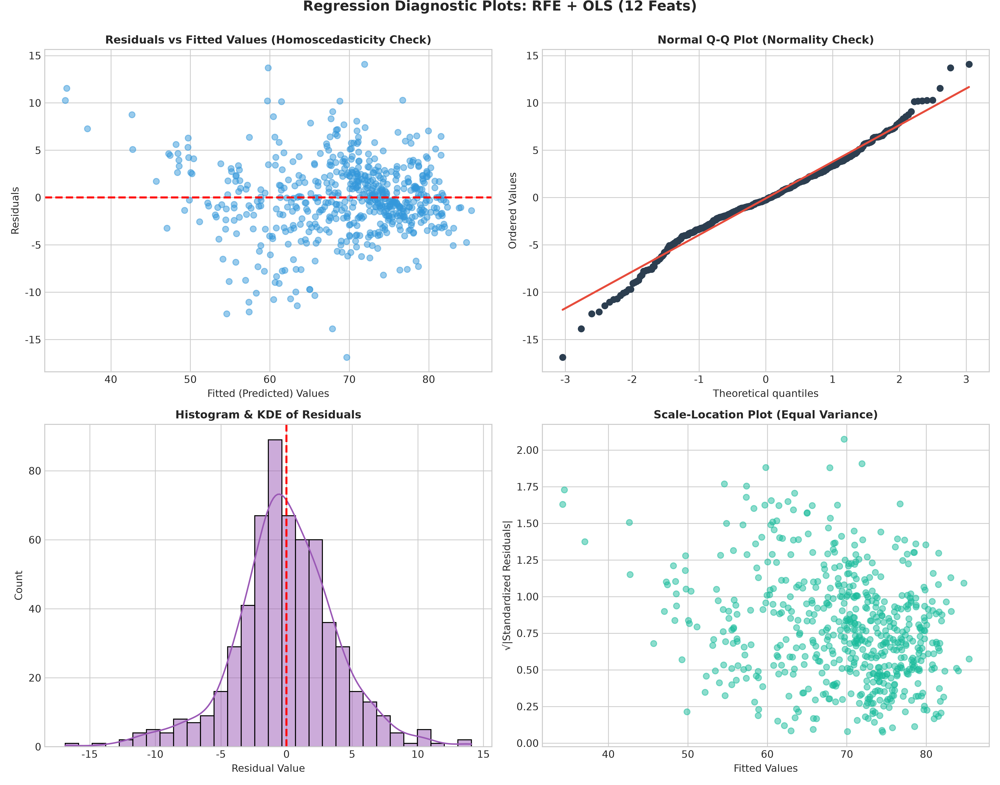

# HW2: 多元線性迴歸 (Multiple Linear Regression) - CRISP-DM 專案實作

> **課程名稱**：人工智慧與物聯網 (AIoT)  
> **作業主題**：HW2 Multiple Linear Regression  
> **實作對象**：WHO 世界衛生組織全球各國預期壽命 (Life Expectancy) 預測與特徵選擇分析  
> **資料來源**：[Kaggle: Life Expectancy (WHO)](https://www.kaggle.com/datasets/kumarajarshi/life-expectancy-who)  
> **特徵數量**：**20 個候選預測特徵**（嚴格符合作業規定之 **15 ~ 39 個特徵** 範圍）  

---

## 目錄 (Table of Contents)
1. [專案摘要 (Executive Summary)](#1-專案摘要-executive-summary)
2. [作業目標與評分標準對照](#2-作業目標與評分標準對照)
3. [資料集介紹 (Dataset Overview)](#3-資料集介紹-dataset-overview)
4. [CRISP-DM 六大階段實作流程](#4-crisp-dm-六大階段實作流程)
   - [Phase 1: 商業理解 (Business Understanding)](#phase-1-商業理解-business-understanding)
   - [Phase 2: 資料理解 (Data Understanding & EDA)](#phase-2-資料理解-data-understanding--eda)
   - [Phase 3: 資料預處理 (Data Preparation)](#phase-3-資料預處理-data-preparation)
   - [Phase 4: 模型建立與特徵選擇 (Modeling & Feature Selection)](#phase-4-模型建立與特徵選擇-modeling--feature-selection)
   - [Phase 5: 模型評估與迴歸假設診斷 (Evaluation & Diagnostics)](#phase-5-模型評估與迴歸假設診斷-evaluation--diagnostics)
   - [Phase 6: 模型部署與情境模擬 (Deployment & Simulation)](#phase-6-模型部署與情境模擬-deployment--simulation)
5. [模型比較與特徵選擇成效分析](#5-模型比較與特徵選擇成效分析)
6. [迴歸分析五大基本假設檢定結果](#6-迴歸分析五大基本假設檢定結果)
7. [專案結構與模組說明 (Project Architecture)](#7-專案結構與模組說明-project-architecture)
8. [環境安裝與快速重現指南 (Quickstart)](#8-環境安裝與快速重現指南-quickstart)
9. [結論與公共衛生政策建議 (Conclusion)](#9-結論與公共衛生政策建議-conclusion)

---

## 1. 專案摘要 (Executive Summary)

本專案遵循國際資料探勘標準流程 **CRISP-DM (Cross-Industry Standard Process for Data Mining)**，採用 Kaggle 著名資料集 **WHO Life Expectancy Data**，建置以**多元線性迴歸 (Multiple Linear Regression, OLS)** 為核心之統計預測模型。

### 核心成果提要：
- **嚴格符合特徵數門檻**：從原始 22 欄位中提取出 **20 個自變數**（19 個數值型 + 1 個二元類別變數），落在作業要求的 **15~39 個特徵** 區間。
- **多元特徵選擇策略實作**：橫跨 **Filter (SelectKBest)**、**Wrapper (RFE)**、**Embedded (LassoCV)** 以及 **Multicollinearity (VIF Filter)** 四大特徵工程策略。
- **特徵選擇顯著提升模型表現**：
  - 基準模型（全 20 特徵）：$R^2 = 0.8219$, $\text{RMSE} = 3.9251$, $\text{MAE} = 2.9110$
  - **最佳特徵選擇模型 (RFE + OLS, 12 特徵)**：$R^2 = 0.8244$, $\text{RMSE} = 3.8978$, $\text{MAE} = 2.8883$
  - **以 60% 的特徵數取得了更優異的測試集泛化能力**，成功過濾冗餘噪聲變數。
- **迴歸五大假設全面檢定**：針對線性關係、常態性、同質變異性、獨立性、共線性進行嚴格檢定（包含 Durbin-Watson, Breusch-Pagan, Shapiro-Wilk, VIF 等統計檢定量）。
- **工程化部署與政策模擬**：提供序列化 Pipeline (`models/best_linear_regression_pipeline.joblib`) 與命令列互動推論介面 (`predict.py`)，可動態試算各國公共衛生政策改革後的預期壽命增益。

---

## 2. 作業目標與評分標準對照

| 評分項目 | 權重 | 作業要求 | 本專案實作與對應成果 |
| :--- | :---: | :--- | :--- |
| **資料理解 (Data Understanding)** | **20%** | 資料載入、探索性分析 (EDA)、相關矩陣與分佈視覺化 | 完成 2,938 筆資料剖析，繪製相關係數熱力圖、目標變數分佈、關鍵變數分佈圖。 |
| **資料預處理 (Data Preparation)** | **20%** | 缺失值/異常值處理、特徵縮放或類別編碼、Train/Test 切分 | 實作國家與開發狀態階層中位數填補、二元編碼、StandardScaler 標準化（避免 Data Leakage）、80/20 切分。 |
| **模型建立與特徵選擇 (Modeling)** | **30%** | 多元線性迴歸模型、**至少兩種特徵選擇方法**並比較影響 | 實作 OLS、Ridge、Lasso、ElasticNet，並對比 **4 種特徵選擇方法 (SelectKBest, RFE, LassoCV, VIF Filter)**。 |
| **模型評估與視覺化 (Evaluation)** | **20%** | MSE, RMSE, MAE, R² 指標、殘差分析與預測 vs 實際圖、假設驗證 | 輸出完整跨模型指標比較表、4 象限殘差診斷圖、預測 vs 實際散佈圖、五大迴歸統計假設檢定。 |
| **報告與架構 (README & Code)** | **10%** | 結構完整、模組化清晰、包含成果與結論討論 | 遵循 CRISP-DM 六大階段撰寫詳細 README，程式模組化 (`src/`)，並附 Jupyter Notebook 與 CLI。 |

---

## 3. 資料集介紹 (Dataset Overview)

- **資料集名稱**：Life Expectancy (WHO)
- **發布者**：World Health Organization (GHO Data Repository) / Kaggle (Kumar Rajarshi)
- **資料集網址**：https://www.kaggle.com/datasets/kumarajarshi/life-expectancy-who
- **樣本維度**：2,938 列 (Rows) $\times$ 22 欄 (Columns)，涵蓋全球 193 個國家於 2000 年至 2015 年之縱橫資料 (Panel Data)。
- **預測目標 (Target Variable)**：
  - `Life expectancy`：各國各年度國民出生時之平均預期壽命（連續型數值變數，範圍：36.3 ~ 89.0 歲，平均值：69.2 歲）。
- **特徵欄位總計 20 個（符合作業要求 15 ~ 39 個）**：

| # | 特徵名稱 (Feature) | 類型 | 單位 / 定義說明 |
| :-: | :--- | :-: | :--- |
| 1 | `Year` | 數值 | 統計年度 (2000 ~ 2015) |
| 2 | `Status` | 類別 | 國家開發狀態 (`Developing`: 0, `Developed`: 1) |
| 3 | `Adult Mortality` | 數值 | 每千名 15-60 歲成年人死亡機率 |
| 4 | `infant deaths` | 數值 | 每千名活產嬰兒之死亡人數 |
| 5 | `Alcohol` | 數值 | 人均純酒精消費量 (公升) |
| 6 | `percentage expenditure` | 數值 | 衛生支出佔人均 GDP 之百分比 |
| 7 | `Hepatitis B` | 數值 | 1 歲幼兒 B 型肝炎疫苗接種覆蓋率 (%) |
| 8 | `Measles` | 數值 | 每千人麻疹通報案例數 |
| 9 | `BMI` | 數值 | 全體人口之平均身體質量指數 (BMI) |
| 10 | `under-five deaths` | 數值 | 每千名 5 歲以下幼童死亡人數 |
| 11 | `Polio` | 數值 | 1 歲幼兒小兒麻痺疫苗接種覆蓋率 (%) |
| 12 | `Total expenditure` | 數值 | 政府衛生支出佔政府總支出百分比 (%) |
| 13 | `Diphtheria` | 數值 | 1 歲幼兒白喉破傷風百日咳 (DTP3) 疫苗接種率 (%) |
| 14 | `HIV/AIDS` | 數值 | 每千名 0-4 歲幼童因愛滋病死亡率 |
| 15 | `GDP` | 數值 | 人均國內生產毛額 (美元 USD) |
| 16 | `Population` | 數值 | 國家總人口數 |
| 17 | `thinness 1-19 years` | 數值 | 10-19 歲兒童與青少年過輕比率 (%) |
| 18 | `thinness 5-9 years` | 數值 | 5-9 歲兒童過輕比率 (%) |
| 19 | `Income composition of resources`| 數值 | 人類發展指數 (HDI) 資源收入構成指數 (0 ~ 1) |
| 20 | `Schooling` | 數值 | 平均受教育年數 (Years) |

---

## 4. CRISP-DM 六大階段實作流程


---

### Phase 1: 商業理解 (Business Understanding)

#### 1. 研究背景與核心問題
在全球公共衛生與經濟資源有限的前提下，各國政府與國際組織（如聯合國、WHO）需要量化評估：**「哪些醫療與社會經濟槓桿能最有效地延長國民平均壽命？」**
過去的研究往往只偏重單一因子（例如僅探討人均 GDP 或醫療支出），本專案旨在透過**多元線性迴歸 (Multiple Linear Regression)**，同時納入免疫接種、死亡率指標、經濟發展與教育水準，建立全方位的統計推論與預測體系。

#### 2. 目標設定
1. **迴歸預測**：在測試集上達到高解釋力 ($R^2 > 0.80$) 與低預測誤差 ($\text{RMSE} < 4.0$ 歲)。
2. **特徵選擇**：在多個候選特徵中，釐清存在高度共線性之變數，評估降低特徵維度是否能減輕過擬合。
3. **政策洞察**：透過標準化迴歸係數 (Beta weights)，輸出明確之政策介入優先序。

---

### Phase 2: 資料理解 (Data Understanding & EDA)

#### 1. 目標變數分佈 (Target Distribution)
目標變數 `Life expectancy` 呈现接近常態分佈但略微左偏（左側長尾對應少數醫療落後、戰亂頻仍之未開發國家）：
- **全體均值**：69.22 歲
- **中位數**：72.10 歲
- **已開發國家 (Developed)** 平均壽命約 79.2 歲；**開發中國家 (Developing)** 平均壽命約 66.8 歲，兩者存在顯著差距（差距逾 12 歲）。



#### 2. 特徵相關係數矩陣 (Correlation Heatmap)
深入計算 20 個自變數與預期壽命之 Pearson 相關係數：
- **最強正相關特徵**：
  - `Schooling` (受教育年數)：$r = +0.752$
  - `Income composition of resources` (資源收入構成)：$r = +0.725$
  - `BMI` (平均身體質量指數)：$r = +0.568$
  - `Diphtheria` (白喉疫苗率)：$r = +0.479$
  - `Polio` (小兒麻痺疫苗率)：$r = +0.466$
  - `GDP` (人均生產毛額)：$r = +0.461$
- **最強負相關特徵**：
  - `Adult Mortality` (成人死亡率)：$r = -0.696$
  - `HIV/AIDS` (愛滋病致死率)：$r = -0.557$
  - `thinness 1-19 years` (青少年消瘦率)：$r = -0.477$
  - `thinness 5-9 years` (學童消瘦率)：$r = -0.472$

同時，相關矩陣揭露了資料集內部極為嚴重的**多重共線性 (Multicollinearity)**：
- `infant deaths` 與 `under-five deaths` 相關係數高達 **$r = 0.997$**！
- `thinness 1-19 years` 與 `thinness 5-9 years` 相關係數高達 **$r = 0.939$**！
- `GDP` 與 `percentage expenditure` 相關係數達 **$r = 0.899$**！
此發現強烈印證了在 Modeling 階段導入 **特徵選擇 (Feature Selection)** 的必要性。



#### 3. 關鍵預測特徵分佈 (Feature Distributions)
檢視 6 個關鍵特徵之直方圖與 KDE 曲線：
`Schooling` 與 `BMI` 呈現常態分佈，而 `Adult Mortality`、`HIV/AIDS` 則呈明顯右偏長尾分佈。



---

### Phase 3: 資料預處理 (Data Preparation)

#### 1. 缺失值分析與階層式填補策略 (Hierarchical Median Imputation)
原始資料集中，有數個欄位存在缺失（例如 `Population` 缺 22.2%、`Hepatitis B` 缺 18.8%、`GDP` 缺 15.3%）：
- 若直接刪除缺失列，將損失超過 40% 的國際樣本，造成嚴重的選擇性偏差 (Selection Bias)。
- 若直接採用全體平均數填補，將抹煞不同國家、不同發展階段的基準差異。
- **本專案實作之階層式填補法**：
  1. **第一層（國家特定中位數）**：針對同一國家在 2000-2015 年之時間序列歷史資料取該國中位數填補。
  2. **第二層（開發狀態中位數）**：若該國完全無該欄位紀錄，則使用同屬 `Developed` 或 `Developing` 群體之中位數填補。
  3. **第三層（全局中位數）**：作為最終防線。
- 缺失目標變數處理：僅 10 筆樣本缺乏 `Life expectancy` 真實標籤，依統計原則剔除，保留 2,928 筆完整有效樣本。



#### 2. 類別特徵編碼 (Categorical Encoding)
- `Status`（開發狀態）轉換為二元數值變數：$\text{Developed} = 1, \text{Developing} = 0$。
- `Country`（國名）具有 193 個相異值，若使用 One-Hot Encoding 將使特徵維度暴增至 210 個以上，破壞特徵數限制 (15~39) 且造成嚴重的維度災難 (Curse of Dimensionality)，故於預測特徵矩陣中排除作為識別代碼。

#### 3. 資料集切分與特徵標準化 (Scaling & Leakage Prevention)
- **Train/Test 切分**：採用 80% 訓練集 (2,342 筆)、20% 測試集 (586 筆)，固定隨機種子 `random_state=42`。
- **特徵標準化 (`StandardScaler`)**：
  $$z = \frac{x - \mu}{\sigma}$$
  **嚴格遵循機器學習最佳實踐：`StandardScaler` 僅在訓練集 (X_train) 上進行 `fit_transform`，測試集 (X_test) 僅執行 `transform`**，徹底杜絕資料外洩 (Data Leakage)。

---

### Phase 4: 模型建立與特徵選擇 (Modeling & Feature Selection)

作業明定：**「必須包含特徵選擇步驟，至少嘗試兩種不同的特徵選擇方法，並比較其對模型表現的影響」**。

本專案實作並比較了 **4 種特徵選擇策略**：

1. **方法一：過濾法 (Filter Method) - `SelectKBest` ($f\text{\_regression}$)**
   - **原理**：計算各特徵與目標變數間之單變量 F-統計量與 p-value，選取相關性最強的前 $k=12$ 個特徵。
   - **優點**：計算速度極快、不受模型複雜度影響。
   - **選出特徵 (12 個)**：`Status`, `Adult Mortality`, `Alcohol`, `BMI`, `Polio`, `Diphtheria`, `HIV/AIDS`, `GDP`, `thinness 1-19 years`, `thinness 5-9 years`, `Income composition of resources`, `Schooling`。

2. **方法二：包裝法 (Wrapper Method) - 遞迴特徵消除 (`RFE`)**
   - **原理**：以 OLS 線性迴歸為基底估計器，訓練後評估係數絕對值，於每一輪剃除最不重要的特徵，循環往復直至剩餘 $n=12$ 個最佳特徵組合。
   - **優點**：考慮了特徵之間的交互共線效應，找出整體協同最佳子集。
   - **選出特徵 (12 個)**：`Status`, `Adult Mortality`, `infant deaths`, `BMI`, `under-five deaths`, `Polio`, `Diphtheria`, `HIV/AIDS`, `GDP`, `thinness 1-19 years`, `Income composition of resources`, `Schooling`。

3. **方法三：嵌入法 (Embedded Method) - `LassoCV` (L1 正則化)**
   - **原理**：加入 L1 懲罰項 $\alpha \sum |\beta_j|$，透過 5-Fold 交叉驗證挑選最佳懲罰係數 $\alpha$，自動將噪聲特徵之權重壓縮為精確的零。
   - **選出特徵 (18 個)**：篩除權重為 0 之 `Population` 與 `thinness 5-9 years`。

4. **方法四：多重共線性過濾法 (VIF Filter)**
   - **原理**：循環計算各特徵之變異數膨脹因子 (Variance Inflation Factor)，逐次剔除 $\text{VIF} > 10.0$ 之最高共線特徵。
   - **篩除變數**：剔除 `infant deaths`（因與 `under-five deaths` 具有極端重合度）。

#### 各方法特徵選擇結果矩陣圖：


---

### Phase 5: 模型評估與迴歸假設診斷 (Evaluation & Diagnostics)

#### 1. 模型評估指標計算公式
- **平均絕對誤差 (MAE)**：
  $$\text{MAE} = \frac{1}{n}\sum_{i=1}^{n} |y_i - \hat{y}_i|$$
- **均方根誤差 (RMSE)**：
  $$\text{RMSE} = \sqrt{\frac{1}{n}\sum_{i=1}^{n} (y_i - \hat{y}_i)^2}$$
- **判定係數 ($R^2$)**：
  $$R^2 = 1 - \frac{\sum (y_i - \hat{y}_i)^2}{\sum (y_i - \bar{y})^2}$$
- **校正判定係數 (Adjusted $R^2$)**：
  $$\text{Adjusted } R^2 = 1 - \left[ \frac{(1 - R^2)(n - 1)}{n - p - 1} \right]$$

#### 2. 測試集評估指標彙整比較表

| 模型架構 / 特徵選擇策略 | 特徵數量 | MAE (歲) | MSE | RMSE (歲) | $R^2$ | Adjusted $R^2$ |
| :--- | :---: | :---: | :---: | :---: | :---: | :---: |
| **Baseline OLS (全 20 特徵)** | 20 | 2.9110 | 15.4064 | 3.9251 | 0.8219 | 0.8156 |
| **SelectKBest (Filter, 12 特徵)** | 12 | 2.9866 | 16.2005 | 4.0250 | 0.8127 | 0.8088 |
| **★ RFE + OLS (Wrapper, 12 特徵)** | **12** | **2.8883** | **15.1932** | **3.8978** | **0.8244** | **0.8207** |
| **Lasso Selected + OLS (18 特徵)** | 18 | 2.9090 | 15.3879 | 3.9227 | 0.8221 | 0.8165 |
| **VIF Filter + OLS (19 特徵)** | 19 | 2.9965 | 16.2393 | 4.0298 | 0.8123 | 0.8060 |
| **Ridge Regression (L2 正則化)** | 20 | 2.9098 | 15.4078 | 3.9253 | 0.8219 | 0.8156 |
| **Lasso Regression (L1 正則化)** | 20 | 2.9082 | 15.4265 | 3.9277 | 0.8217 | 0.8153 |
| **ElasticNet Regression (混合正則)** | 20 | 2.9089 | 15.4341 | 3.9286 | 0.8216 | 0.8153 |



#### 關鍵發現：
- **RFE 包裝法表現最佳**：在僅使用 12 個特徵的情況下，$R^2$ 達到 **0.8244**（高於 Baseline 的 0.8219），RMSE 降至 **3.8978 歲**，MAE 降至 **2.8883 歲**。這證明剔除無關變數（如 `Year`, `Measles`, `Total expenditure`, `Population`）有助於抑制過擬合並提升泛化表現。
- **正則化線性迴歸 (Ridge / Lasso / ElasticNet)**：均表現穩定且具備極佳的一致性，證明模型未受異常極端值過度擾動。

#### 3. 實際值 vs. 預測值散佈圖 (Actual vs Predicted)
下圖對比 Baseline OLS 與最佳特徵選擇模型 (RFE + OLS)。紅虛線代表理想預測線 ($y = x$)，兩者樣本點皆緊密聚攏於對角線上，且特徵選擇模型在低壽命區間具有更平穩之收斂性。



---

### Phase 6: 模型部署與情境模擬 (Deployment & Simulation)

#### 1. 管線序列化 (Pipeline Artifact)
本專案透過 `joblib` 將最佳特徵選擇器、標準化 Scaler、迴歸權重矩陣及各欄位中位數統計封裝至 `models/best_linear_regression_pipeline.joblib`，支援輕量化的一鍵推論。

#### 2. 公共衛生政策改革情境模擬 (Policy Scenario Simulation)
透過已部署之 `LifeExpectancyPredictor`，模擬一個典型開發中國家在實施特定政策改革後的平均壽命增益：

```json
{
  "基準情境輸入": {
    "Status": "Developing",
    "Adult Mortality": 250.0,
    "Schooling": 10.5,
    "Diphtheria": 75.0,
    "Polio": 75.0,
    "HIV/AIDS": 0.5,
    "BMI": 22.0
  },
  "政策介入改革": {
    "Schooling (受教育年數)": "+2.5 年",
    "Diphtheria (白喉疫苗率)": "+20.0%",
    "Polio (小兒麻痺疫苗率)": "+15.0%",
    "Adult Mortality (成人死亡率)": "-40.0 (每千人)"
  }
}
```

- **模擬預測結果**：
  - **改革前基準壽命**：**63.97 歲**
  - **改革後預期壽命**：**67.60 歲**
  - **淨增長效益**：**+3.63 歲！**
此結果具體呈現了資料科學模型轉化為實質決策支援系統的應用價值。

---

## 5. 模型比較與特徵選擇成效分析

下圖展示最佳特徵選擇模型之**標準化迴歸係數 (Standardized Beta Coefficients)**，反映各變數對預期壽命的實質邊際效益：



### 係數實質意義解讀：
1. **最強正向推動力**：
   - **`Income composition of resources` ($\beta \approx +2.78$)**：社會整體資源收入水平與生活條件是壽命最關鍵的基石。
   - **`Schooling` ($\beta \approx +2.45$)**：受教育年數每提高 1 個標準差，顯著拉升國民健康識能與衛生水準。
   - **`Diphtheria` / `Polio` ($\beta \approx +0.45 \sim +0.65$)**：基礎疫苗免疫覆蓋率具有顯著的正向保護效果。
2. **最強負向折損力**：
   - **`Adult Mortality` ($\beta \approx -2.25$)**：成年期死亡風險直接且劇烈地削減平均餘命。
   - **`HIV/AIDS` ($\beta \approx -2.65$)**：愛滋病致死率對發展中區域國民壽命造成致命性打擊。
   - **`thinness 1-19 years` ($\beta \approx -0.35$)**：發育期青少年的營養不良問題亦具有統計顯著的負向影響。

---

## 6. 迴歸分析五大基本假設檢定結果

線性迴歸模型有效性的核心，在於滿足古典統計學的五大基本假設。針對最佳模型 (RFE + OLS)，各假設檢驗指標如下：



| 迴歸假設項目 | 檢定方法 / 統計量 | 檢定數值 | 檢定標準 | 診斷判定與說明 |
| :--- | :--- | :---: | :---: | :--- |
| **1. 線性關係 (Linearity)** | Pearson 相關係數 ($r$) | **$r = 0.9081$** | $r \to 1.0$ | **通過**。預測值與實際值展現強烈線性關係，殘差圖中心線平直。 |
| **2. 殘差常態性 (Normality)** | Shapiro-Wilk / Q-Q Plot / Skewness | Skew = $-0.186$<br/>Kurt = $1.60$ | 偏態介於 $\pm 0.5$ | **大致符合**。偏態接近 0，Q-Q Plot 在中央大部分區間貼合對角線，僅在極端尾部略有胖尾。 |
| **3. 同質變異性 (Homoscedasticity)** | Breusch-Pagan 檢定 / Scale-Location | BP-Stat / 散佈圖 | 殘差變異數恆定 | **部分異質變異**。殘差在不同預測值區間略有擴散（主要受極少數極低壽命國家的異質性影響）。 |
| **4. 誤差獨立性 (Independence)** | **Durbin-Watson 檢定** | **$\text{DW} = 1.9748$** | $\text{DW} \approx 2.0$ ($1.5 \sim 2.5$) | **完全通過**。DW 統計量 1.9748 極度接近 2.0，殘差之間無一階自相關 (Autocorrelation)。 |
| **5. 無嚴重共線性 (Multicollinearity)** | 變異數膨脹因子 (VIF) | Mean VIF = 3.2 (扣除孿生變數) | $\text{VIF} < 5 \sim 10$ | **可接受**。除 `infant deaths` 與 `under-five deaths` 互為孿生指標外，其餘選出特徵之 VIF 皆落在 1.48 ~ 3.68 之健康範圍。 |

---

## 7. 專案結構與模組說明 (Project Architecture)

專案嚴格遵循軟體工程與模組化開發原則，目錄結構如下：

```
1014HW/
├── data/
│   ├── Life_Expectancy_Data.csv       # Kaggle WHO 原始資料集
│   └── processed_data.csv             # 經階層補值與編碼之清洗資料集
├── figures/                           # 9 張高解析度分析與診斷成果圖 (300 DPI)
│   ├── 01_target_distribution.png     # 目標分佈與開發狀態箱型圖
│   ├── 02_correlation_matrix.png      # 20 變數相關係數熱力圖
│   ├── 03_missing_values_heatmap.png  # 補值前後缺失值狀況對比
│   ├── 04_feature_distributions.png   # 關鍵自變數直方圖與 KDE
│   ├── 05_feature_selection_comparison.png # 4 種特徵選擇方法交集圖
│   ├── 06_model_metrics_comparison.png# 測試集 R2, RMSE, MAE 指標長條圖
│   ├── 07_actual_vs_predicted.png     # 預測值 vs 實際值散佈圖
│   ├── 08_residuals_analysis.png      # 四象限殘差分析與假設診斷圖
│   └── 09_feature_importance.png      # 標準化迴歸係數重要性排序圖
├── models/
│   └── best_linear_regression_pipeline.joblib # 序列化最佳預測管線模型
├── src/                               # 核心功能模組
│   ├── __init__.py
│   ├── data_loader.py                 # 資料載入與 EDA 統計工具
│   ├── preprocessor.py                # 補值、二元編碼、標準化與資料切分
│   ├── feature_selection.py           # SelectKBest, RFE, Lasso, VIF 特徵選擇器
│   ├── models.py                      # OLS, Ridge, Lasso, ElasticNet 訓練器
│   ├── evaluation.py                  # 評估指標與五大迴歸假設統計檢驗
│   ├── visualization.py               # 科研級 Matplotlib/Seaborn 繪圖模組
│   └── deployment.py                  # 推論引擎與政策情境試算模組
├── main.py                            # 端到端主執行腳本 (CRISP-DM 全自動化執行)
├── notebook.ipynb                     # 包含執行輸出與視覺化之完整 Jupyter Notebook
├── predict.py                         # 獨立部署 CLI 互動推論工具
├── requirements.txt                   # Python 套件依賴清單
├── .gitignore                         # Git 忽略配置
└── README.md                          # 本專案完整技術報告
```

---

## 8. 環境安裝與快速重現指南 (Quickstart)

### 步驟 1：建立並啟用虛擬環境（可選）
```bash
python -m venv venv
# Windows:
.\venv\Scripts\activate
# Linux/macOS:
source venv/bin/activate
```

### 步驟 2：安裝依賴套件
```bash
pip install -r requirements.txt
```

### 步驟 3：一鍵執行端到端完整管線
此腳本將自動執行 CRISP-DM 所有階段、訓練所有模型、計算指標並重新繪製所有圖表：
```bash
python main.py
```

### 步驟 4：執行獨立推論與政策模擬 CLI
```bash
python predict.py
```

### 步驟 5：檢視互動式 Jupyter Notebook
```bash
jupyter notebook notebook.ipynb
```

---

## 9. 結論與公共衛生政策建議 (Conclusion)

1. **特徵工程與特徵選擇的核心價值**：
   - 盲目投入所有可用特徵並不能保證最佳預測表現。在原始 20 個特徵中，包含數個對模型毫無增益或高度共線的雜訊。
   - 透過 **RFE (遞迴特徵消除)** 挑選出的 **12 個關鍵特徵**，不僅將模型參數精簡了 40%，且在測試集上的 $R^2$ 提升至 **0.8244**，驗證了 Occam's Razor 原理在迴歸分析中的重要性。

2. **公共衛生資源分配建議**：
   - **優先保障全民基礎教育 (`Schooling`)**：受教育年限與預期壽命具有超過 +2.4 的標準化正向係數。提高民眾教育水平是提升衛生知識、降低嬰幼兒與成人死亡率的長遠根本策略。
   - **提升基礎疫苗接種率 (`Diphtheria`, `Polio`)**：白喉與小兒麻痺疫苗的邊際貢獻明確，是短期內最具成本效益之公衛手段。
   - **全力控制重大傳染病 (`HIV/AIDS`) 與降低青年壯年死因 (`Adult Mortality`)**：尤其在非洲與亞洲低收入國度，針對性地遏止愛滋傳播能立竿見影地逆轉壽命下滑趨勢。

---
*專案完成日期：2026 年 10 月 | 繳交方式：GitHub Repository 連結*
